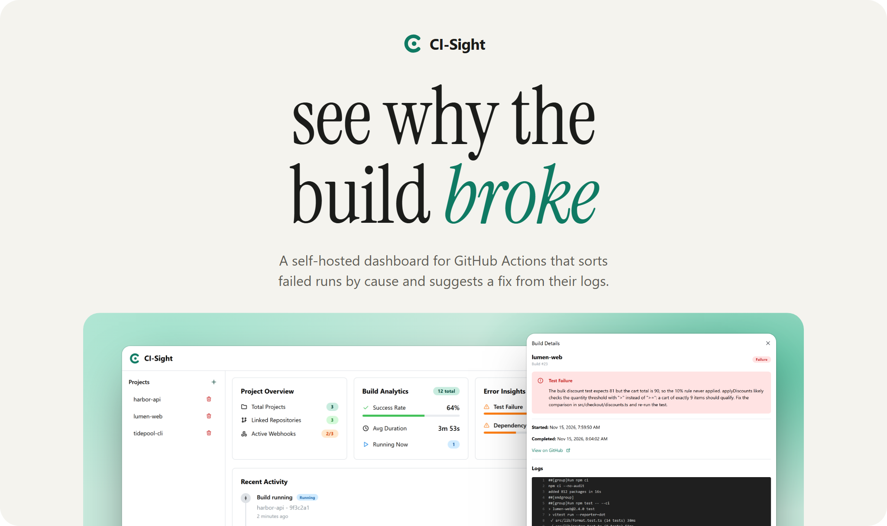
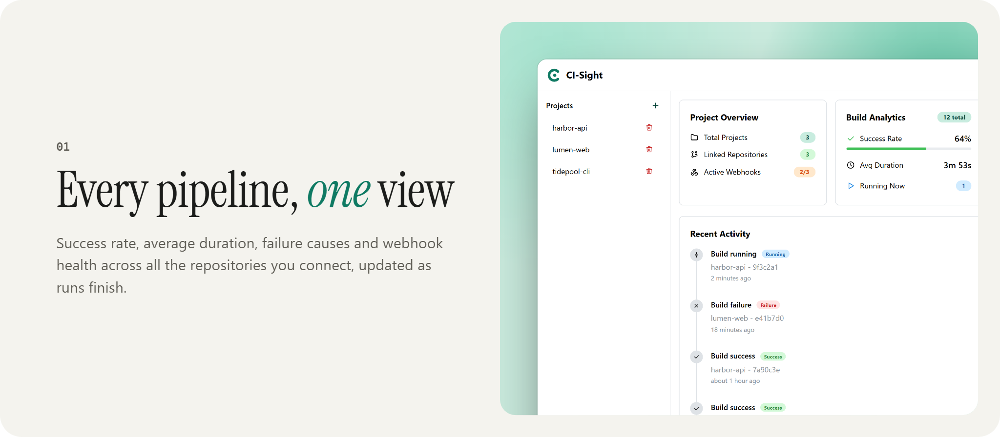
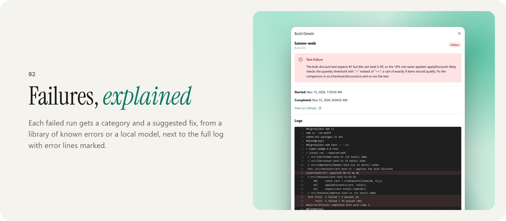
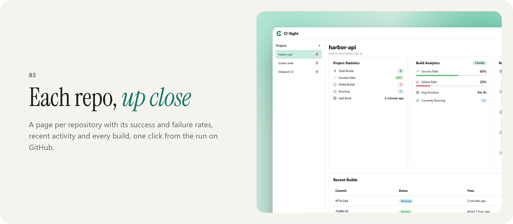

<picture>
  <source media="(prefers-color-scheme: dark)" srcset=".github/readme/hero-dark.png">
  
</picture>

<p align="center">
  <a href="#run-it"><b>Run it</b></a>
  &nbsp;·&nbsp;
  <a href="https://github.com/Anthonyy232/CI-Sight/actions/workflows/checks.yml"><b>Checks</b></a>
</p>

CI-Sight is a self-hosted dashboard for GitHub Actions. Sign in with GitHub, pick your repositories, and it follows their workflow runs through webhooks. When a run fails, it reads the log, sorts the failure into a category and suggests a fix, either from a library of known errors or from a local language model running in [Ollama](https://ollama.com).

> [!NOTE]
> CI-Sight is a personal project from 2025 and isn't actively developed. It builds and its tests pass on current dependencies, but the full stack (database, queue, models and a GitHub OAuth app) hasn't been run end to end since 2025. Issues and pull requests are still welcome.

<picture>
  <source media="(prefers-color-scheme: dark)" srcset=".github/readme/feature-dashboard-dark.png">
  
</picture>

The dashboard shows, across every repository you've added:

- **Build analytics**: success rate, average duration and how many runs are in progress.
- **Error insights**: the share of recent failures in each category.
- **Repository health**: which repositories have their webhook registered.
- **Recent activity** and **recent builds**, refreshed every 30 seconds.

<picture>
  <source media="(prefers-color-scheme: dark)" srcset=".github/readme/feature-failures-dark.png">
  
</picture>

Click a build to open its details. For a failed run, CI-Sight downloads the log, finds the error line and classifies it as a dependency error, test failure, syntax error, runtime error or build environment error. It then looks for a similar error in its library of known errors. If none is close enough, it asks the local model for a fix, with values that look like keys and tokens redacted from the log first. The full log sits below, with error lines highlighted, and a link opens the run on GitHub.

<picture>
  <source media="(prefers-color-scheme: dark)" srcset=".github/readme/feature-projects-dark.png">
  
</picture>

Each repository has its own page with its build count, success and failure rates, average duration, recent activity and builds. Add a repository with **+** next to **Projects**: CI-Sight creates the webhook on GitHub for you. Deleting the project removes the webhook too.

The dashboard follows your system's light or dark theme.

## Run it

You need [Node.js](https://nodejs.org) 24, [Docker](https://www.docker.com) for PostgreSQL (with pgvector) and Redis, Python 3 for the models, and a public HTTPS address for GitHub's webhooks, such as an [ngrok](https://ngrok.com) tunnel. [Ollama](https://ollama.com) is optional: without it, failures still get a category and the closest known fix.

1. Clone the repository and copy the example settings:

   ```bash
   git clone https://github.com/Anthonyy232/CI-Sight.git
   cd CI-Sight
   cp .env.example .env
   ```

2. [Create a GitHub OAuth app](https://github.com/settings/applications/new) with the callback URL `http://localhost:5173/api/auth/github/callback`, and put its client ID and secret in `.env`. Set `PUBLIC_URL` to your tunnel's address and fill in the three secrets; `openssl rand -base64 32` makes a good one.

3. Start PostgreSQL and Redis:

   ```bash
   docker compose up -d
   ```

4. Set up the Python environment for the models:

   ```bash
   python3 -m venv ml/venv
   source ml/venv/bin/activate
   pip install -r ml/requirements.txt
   ```

   On Windows, set `PYTHON_EXECUTABLE=ml/venv/Scripts/python.exe` in `.env`.

5. Install, create the database and load the known errors:

   ```bash
   npm ci && npm ci --prefix client && npm ci --prefix server
   npx --prefix server prisma migrate dev --schema server/prisma/schema.prisma
   python3 ml/scripts/seed_known_errors.py
   ```

6. Start the server and the dashboard:

   ```bash
   npm run dev
   ```

   Open http://localhost:5173 and sign in with GitHub.

The models are downloaded from Hugging Face the first time they run: [facebook/bart-large-mnli](https://huggingface.co/facebook/bart-large-mnli) for categories and [sentence-transformers/all-MiniLM-L6-v2](https://huggingface.co/sentence-transformers/all-MiniLM-L6-v2) for finding similar errors. The default Ollama model is `codellama:7b`; change it with `OLLAMA_MODEL`.

Build logs are downloaded with your GitHub sign-in. If they don't appear, add a personal access token with the `repo` scope under **Set GitHub Token** in the menu under your name.

### Serving a build

On Linux or macOS, build both parts and start the server in production mode. It serves the dashboard and the API from one address, so set `FRONTEND_URL` and `PUBLIC_URL` to that address and use `<address>/api/auth/github/callback` as the OAuth callback.

```bash
npm --prefix client run build
npm --prefix server run build
NODE_ENV=production npm --prefix server start
```

Put a reverse proxy such as Caddy or nginx in front of it for HTTPS.

## Contributing

Contributions are welcome. Read [AGENTS.md](AGENTS.md) before opening a pull request, and run `npm run check`, which builds the dashboard, type checks the server and runs its tests. The tests mock the database, Redis, GitHub and the models, so they need none of them.

## License

Copyright (c) 2025 Anthony La.

CI-Sight is free software, licensed under the [GNU General Public License v3.0](LICENSE) only, and comes with no warranty. The first commits, made on 24 September 2025, were published under the MIT License.

The models it downloads keep their own licences.
